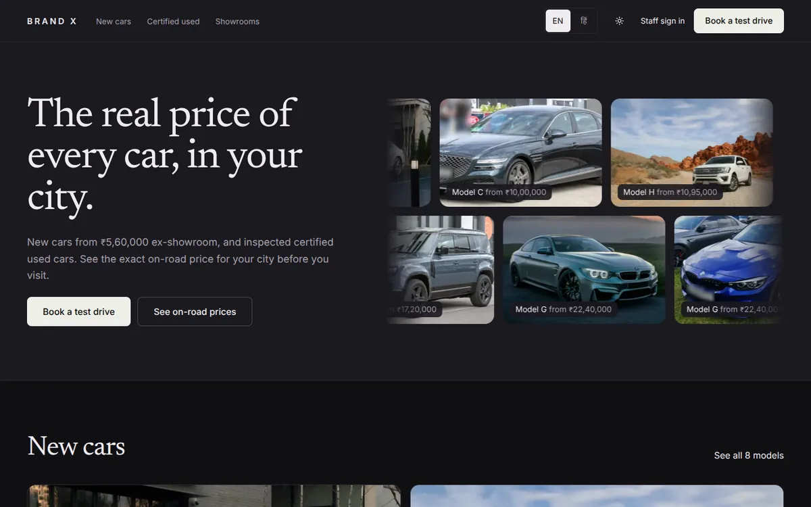
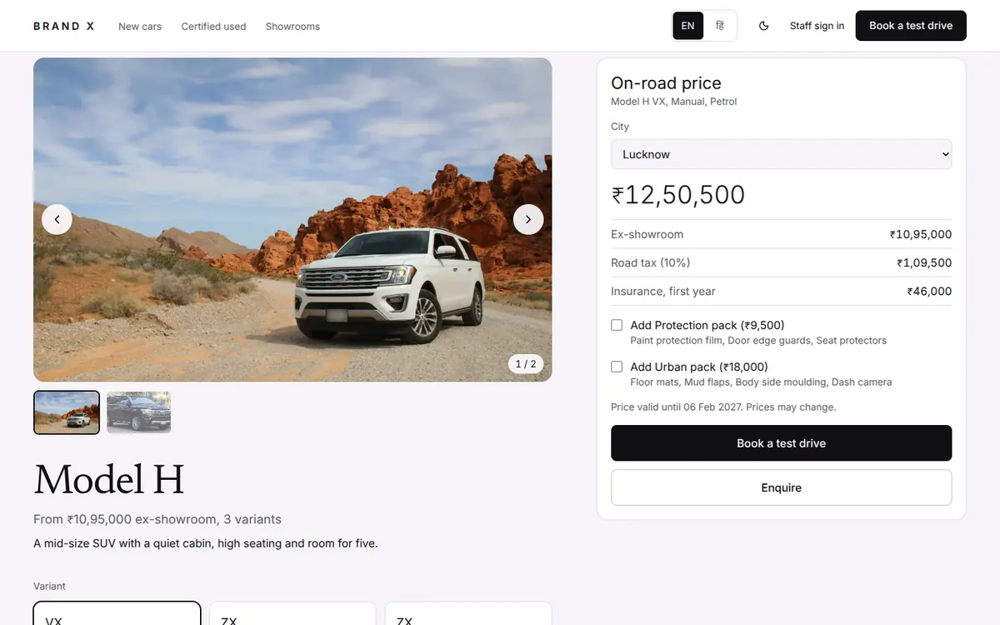
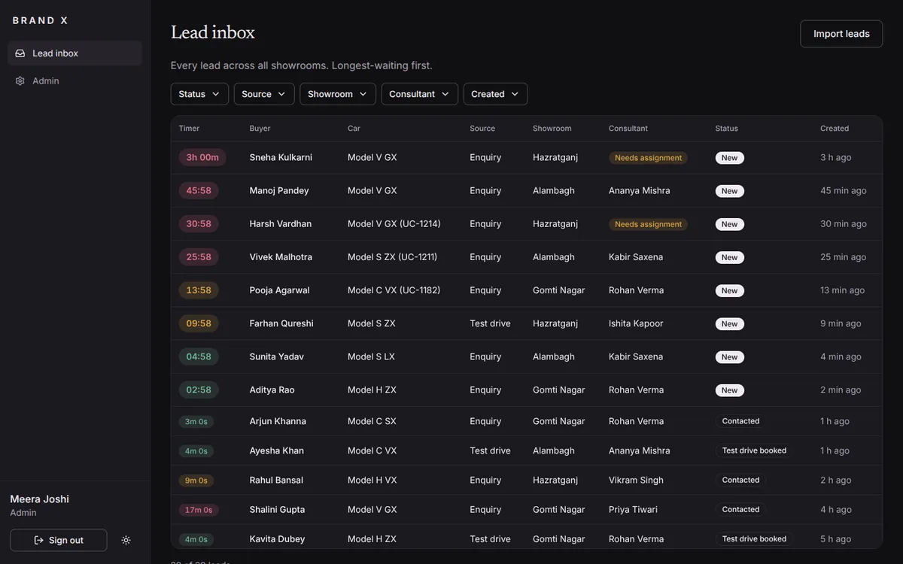
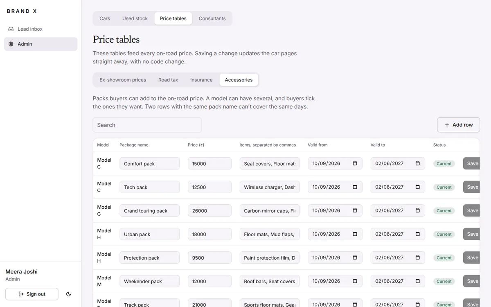
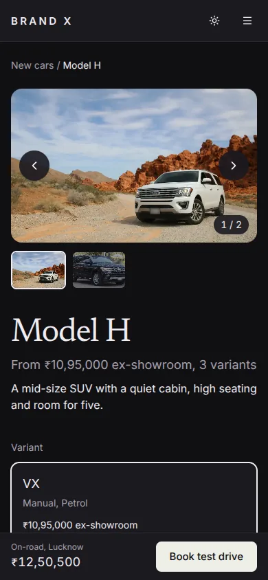

# Brand X Lucknow

A dealer website for the fictional Brand X: new-car pages with an exact on-road price breakup by city, certified used cars, test-drive and service booking, a lead inbox with automatic assignment, AI help for consultants, and an admin for cars, used stock and prices. It works in English and Hindi, in light and dark.

**Live demo:** _the link is added here once the site is deployed_ &nbsp;|&nbsp; **Code:** [github.com/sarthak070707/brandx-dealer](https://github.com/sarthak070707/brandx-dealer)

<p align="center">
  
  
</p>
<p align="center">
  
  
</p>
<p align="center">
  
</p>

## Try it

1. Open the site and choose **Staff sign in** in the footer. The page shows the demo logins: an admin, and the steps to reach a consultant from there.
2. Everything on the site is sample data. Buyers need no account: try booking a test drive, a service visit, a trade-in, or the EMI calculator on any car page.
3. Switch language with the **EN / हिं** button, and theme with the sun and moon button.

## What it does

**For buyers**

- **New cars** with the exact on-road price for their city: ex-showroom price, road tax and first-year insurance, plus any accessory packs they tick. The price comes only from tables the admin maintains.
- **EMI calculator** on every car page and used car, starting from the on-road price.
- **Certified used cars** with filters, a six-area inspection report and score, and a masked registration number.
- **Test-drive booking** (30-minute slots over the next 14 days), **service booking** (three bays per slot) and a **trade-in** form. Each gives a confirmation page with a cancel link, and each becomes a lead.
- **Hindi and English** across the whole public site.
- **Privacy built in:** explicit consent on every form, a signed one-tap "stop messages" link in every message, and a privacy page.

**For staff**

- **Lead inbox** for every source (enquiry, test drive, trade-in, service, portal import). Leads are assigned automatically by showroom and car to the consultant with the fewest open leads, with response timers that turn amber and red. Consultants see their own leads; admins see all.
- **AI assistant** (summary, what to ask next, and a draft reply in the buyer's language). A consultant always edits and approves; nothing is sent automatically.
- **CSV lead import** from portals, with a row-by-row preview, clear reasons for rejected rows, and duplicate detection.
- **Admin:** cars (variants, colours, photo upload), used stock (inspection report, status, and an AI-explained price band), price tables (edited in place, with one-press fixes for overlapping dates), and consultants (one-time temporary passwords, deactivate, reset).

## How it is built

- **Money is whole paise.** The on-road price is one small function that runs on the server and in the browser; a test checks the two agree for every combination of accessory packs.
- **The AI can only help, never decide.** After the model answers, plain code removes any rupee amount that is not an admin price, any mention of a discount, and any seat count the car's own data doesn't confirm. A price is allowed only if the buyer asked about money. If the AI fails or is slow, the consultant gets a template reply. The used-car price band is worked out by a visible rule of thumb; the AI only explains it.
- **Double bookings are impossible, not just unlikely.** A partial unique index in the database allows one confirmed booking per demo car per slot, and one per service bay per slot. Tests book the same slot at the same moment against a real database, and fail if the rule is removed.
- **Privacy and access.** Stop-messages links are signed (HMAC). Passwords are hashed with bcrypt. Wrong sign-in attempts are limited per email and per visitor address, and only scrambled versions of those are stored. Access rules are enforced in the routing layer and again in every staff query.
- **Logic lives in `lib/` as plain, tested functions.** Pricing, booking rules, lead assignment, the AI guard, the CSV reader, EMI and the price band need no database or browser to test.
- **Guards against drift.** Tests fail if an English message has no Hindi version, if a text colour drops below the accessibility minimum in either theme, or if the seed forgets to clear a table.
- **Fast by default.** Public pages use Next.js cache components, tagged so an admin change refreshes them. On the pages checked, Lighthouse (run locally) gave accessibility, best practices and SEO of 100, and a largest paint of 1 to 1.9 seconds on a 4G profile.

## Tech stack

Next.js 16 (App Router, cache components), React 19, TypeScript, Tailwind CSS 4, Radix UI, Prisma 7 with PostgreSQL (Neon), Auth.js (credentials, JWT sessions), next-intl, Zod, Vitest, and an OpenAI-compatible AI provider (Groq, default model `openai/gpt-oss-120b`). CI runs on GitHub Actions; the site is deployed on Vercel.

## Run it yourself

You need Node.js 22 or newer and a PostgreSQL database (a free [Neon](https://neon.tech) project works).

```bash
git clone https://github.com/sarthak070707/brandx-dealer.git
cd brandx-dealer
npm install
cp .env.example .env        # on Windows PowerShell: copy .env.example .env
```

Fill in `.env` (see the table below), then:

```bash
npx prisma migrate deploy   # creates the tables
npm run seed                # fills in the sample data
npm run dev                 # http://localhost:3000
```

> `npm run seed` **clears every table first**, so it always gives the same sample data. Never run it against a database you want to keep.

### Environment variables

| Name | What it is |
| --- | --- |
| `DATABASE_URL` | The pooled Postgres connection string the app uses. |
| `DATABASE_URL_UNPOOLED` | The direct connection string, used by migrations. |
| `NEXTAUTH_SECRET` | A long random string. It signs logins and the stop-messages links. Make one with `node -e "console.log(require('crypto').randomBytes(32).toString('base64'))"`. |
| `NEXTAUTH_URL` | The site's address, for example `http://localhost:3000`. |
| `LLM_API_KEY` | An API key for the AI provider (Groq). Optional: without it the AI features fall back to plain template text. |
| `LLM_MODEL`, `LLM_BASE_URL` | Optional. Switch the model or provider without changing code. |
| `SHOW_DEMO_LOGINS` | Set to `false` to hide the demo logins on the staff sign-in page. Shown when empty. |

### Scripts

| Command | What it does |
| --- | --- |
| `npm run dev` | Starts the site for development. |
| `npm run build` / `npm start` | Builds and runs the production version. |
| `npm run lint` | Checks the code style. |
| `npm test` | Runs the unit tests (over 450 of them; no database needed). |
| `npm run test:db` | Runs the tests that need a real database: double bookings, service bays and the sign-in limit. They add and remove a few rows, so use a development database. |
| `npm run seed` | Resets the database to the sample data. |

## Tests and CI

Every push and pull request runs GitHub Actions: lint, type check, unit tests, a dependency vulnerability check, a throwaway Postgres built from the migrations and filled with the sample data, the database tests, and a production build.

## Project structure

```
app/            Routes: the public site under [locale], plus consultant/ and admin/
components/     Screens and widgets, grouped by area (car, used, booking, service, admin, staff)
lib/            Plain tested logic: pricing, booking, leads, ai, finance, used-cars, auth
prisma/         Schema, migrations and the seed
messages/       en.json and hi.json (kept in step by a test)
i18n/, proxy.ts Language routing and access control
.github/        The CI workflow
```

## Known limits

- **Text written in the admin** (such as a new car's description) shows in English on the Hindi pages until a Hindi version is added to `messages/hi.json`.
- **The WhatsApp messages are simulated.** They are written to an outbox and shown in the lead's history; nothing is sent.
- **Uploaded car photos are stored in the database.** Fine for a demo; a file store would be the next step at scale.
- **No self-service password change.** An admin resets a consultant's password.
- **Not-found pages return status 200** (with `noindex`), a side effect of how cache components render them.
- **The used-car price band is a rule of thumb,** from the new price, age, distance, owners and inspection score. It knows nothing about demand or local offers.
- **After an admin edit,** a production build may show the previous version of a pre-built page to the very first visitor.

## Built by

[Sarthak Arya](https://www.linkedin.com/in/sarthak-arya-059920303)

## Photo credits

All car photos are free-licence stock images of real cars, used to stand in for the
fictional Brand X models (assumption A12). Edited photos are cropped, resized and have
number plates, faces, signs and dealer text blurred. Edited versions of CC BY-SA photos are
shared under the same licence.

| Model | Colour | Photo | Licence |
| --- | --- | --- | --- |
| Model H | Oxford White | [Sven D](https://unsplash.com/@steven1302), Unsplash | [Unsplash License](https://unsplash.com/license) |
| Model H | Midnight Black | "2022 Ford Expedition Platinum" by Kevauto, [Wikimedia Commons](https://commons.wikimedia.org/w/index.php?curid=132494252) | [CC BY-SA 4.0](https://creativecommons.org/licenses/by-sa/4.0/) |
| Model C | Pearl White | [Hyundai Motor Group](https://unsplash.com/@hyundaimotorgroup), Unsplash | [Unsplash License](https://unsplash.com/license) |
| Model C | Deep Teal | "Genesis G80 IAA 2021" by Alexander Migl, [Wikimedia Commons](https://commons.wikimedia.org/w/index.php?curid=109896459) | [CC BY-SA 4.0](https://creativecommons.org/licenses/by-sa/4.0/) |
| Model S | Pure White | [Zakaria Issaad](https://unsplash.com/@alpha_photographer), Unsplash | [Unsplash License](https://unsplash.com/license) |
| Model S | Tornado Red | "2017 Volkswagen Golf GTi TSi 2.0 Front" by Vauxford, [Wikimedia Commons](https://commons.wikimedia.org/wiki/File:2017_Volkswagen_Golf_GTi_TSi_2.0_Front.jpg) | [CC BY-SA 4.0](https://creativecommons.org/licenses/by-sa/4.0/) |
| Model V | Graphite Grey | [Hyundai Motor Group](https://www.pexels.com/@hyundaimotorgroup/), Pexels | [Pexels License](https://www.pexels.com/license/) |
| Model V | Pearl White | "2022 Kia Carnival LXS, Front Left" by SsmIntrigue, Wikimedia Commons | [CC BY-SA 4.0](https://creativecommons.org/licenses/by-sa/4.0/) |
| Model T | Gondwana Stone | [serjan midili](https://unsplash.com/@s_midili), Unsplash | [Unsplash License](https://unsplash.com/license) |
| Model T | Slate Blue | "Land Rover Defender (L663)" by Alexander Migl, Wikimedia Commons | [CC BY-SA 4.0](https://creativecommons.org/licenses/by-sa/4.0/) |
| Model G | Mineral Grey | Josh Berquist, Unsplash | [Unsplash License](https://unsplash.com/license) |
| Model G | Marina Blue | "2020 BMW M4 Comp F82 FOS22" by MrWalkr, Wikimedia Commons | [CC BY-SA 4.0](https://creativecommons.org/licenses/by-sa/4.0/) |
| Model M | Pearl White | [Fariz Priandana](https://www.pexels.com/@farizprdn/), Pexels | [Pexels License](https://www.pexels.com/license/) |
| Model M | Onyx Black | "Mitsubishi Delica D:5 G-Power package (2007)" by Tennen-Gas, Wikimedia Commons | [CC BY-SA 3.0](https://creativecommons.org/licenses/by-sa/3.0/) |
| Model R | Oryx White | [Vadym Kudriavtsev](https://unsplash.com/@clipnjoy), Unsplash | [Unsplash License](https://unsplash.com/license) |
| Model R | Indium Grey | "Volkswagen Golf R-Line (Mk7, Typ 5G) China" by Dinkun Chen, Wikimedia Commons | [CC BY-SA 4.0](https://creativecommons.org/licenses/by-sa/4.0/) |
